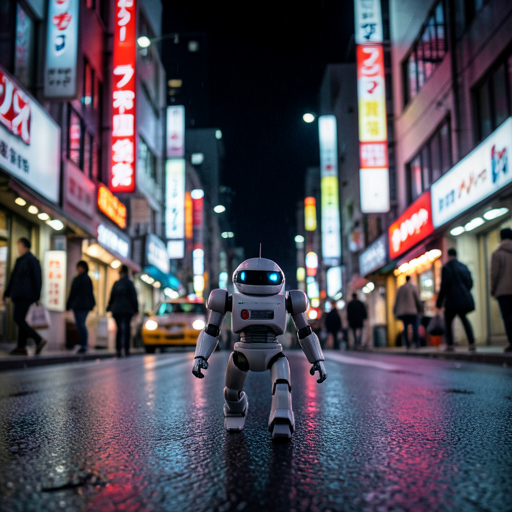
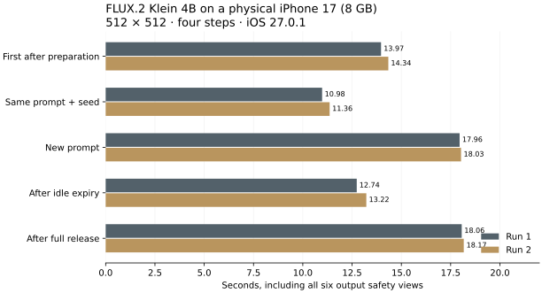

# ローカル画像生成 — FLUX.2 on iPhone

The active `SDXLCoreMLTest` iPhone app runs **FLUX.2 Klein 4B, 512×512, four steps** with Apple's CoreAI GPU runtime. Prompt encoding, generation and mandatory output safety checks run on the device. Physical validation used an **iPhone 17, 8 GB RAM, iOS 27.0.1 / 24A446**, on 2026-10-13/14. This repository preserves the [earlier Stable Diffusion conversion work](docs/legacy-conversion.md).



[26-second real-device demo](media/iphone17-flux2-demo.mp4) · [15-second download recording](media/iphone17-model-download.mp4) · [JSON / CSV measurements](measurements/2026-10-14/README.md) · [Related work and reporting scope](docs/flux2-ios-report.md)

## Current device requirement

The current source lowers the app guard to **6 GB RAM** (5,500,000,000 reported physical bytes) and keeps iOS 27.0.1 as the minimum. It adopts the successful iPhone 14 experiment's asset-summary metadata lookup and signs both Debug and Release with Apple's [Extended Virtual Addressing entitlement](https://developer.apple.com/documentation/bundleresources/entitlements/com.apple.developer.kernel.extended-virtual-addressing). This expands address space; it does not increase physical RAM. Four-GB devices remain unsupported. Six-GB generation can take substantially longer than the iPhone 17 measurements below.

The October 13/14 measurements describe the earlier eight-GB production configuration and separate six-GB experiments. Their source provenance, conditions and timings are preserved. The six-GB change preserved model bytes, four steps, input filtering and all six output safety checks. The [October 15 production-configuration check](measurements/2026-10-15/sixgb-support/summary.json) completed model verification/installation and two checked images on iPhone 14 / iOS 27.2, without a low-memory test override. App-reported image times were 99.4 seconds (first transformer compilation) and 53.1 seconds (changed prompt), after separate initial preparation. The pending archive was USB seeded; this check did not repeat the network download.

## Using the app

Japanese-labelled examples fill in English prompts for a still life, landscape, robot or watercolor illustration. Selecting an example does not start generation. Preparation and generation show elapsed time and support cancellation; native model work may take time to finish cancelling. Approved images appear with Save and Share actions, with their prompt and seed in a collapsed details section.

The previous approved image, prompt and seed remain available while generating and after refusal, cancellation or failure. Only a newly approved image replaces them. Results are temporary in-memory state, not an image library. Sharing captures the selected checked image; saving requests add-only Photos permission and offers Settings guidance after denial.

The app includes its own `PrivacyInfo.xcprivacy` for preferences, disk-space checks, own-container file metadata and elapsed-time measurement. [Privacy](docs/privacy.html) and [support](docs/support.html) describe local processing, the first model download and result retention.

## First use and app size

The app includes onboarding and an explicit download announcement. Generation weights are **excluded from the default build**. The safety classifier stays bundled. The tested signed development app is approximately **30 MB**, compared with approximately **4.07 GB** when generation weights were bundled. These are app-directory measurements, not App Store download-size estimates.

| Storage item | Bytes | Decimal size |
| --- | ---: | ---: |
| First model download | 3,542,141,404 | 3.54 GB |
| Installed generation files | 4,043,710,174 | 4.04 GB |
| Initial free-space check, including cache budget | 8,830,581,086 | About 9 GB free |

The tested app container also held 4,032,691,053 bytes of CoreAI compilation cache, in addition to model files. Total model/cache/app usage is approximately 8.2 GB; cache growth can vary. The initial free-space check includes a 4.25 GB runtime-cache budget and margin.

MiM's existing Cloudflare R2 server supplies 18 resumable fragments. Wi-Fi is the default; cellular data requires an explicit switch. Pausing or backgrounding retains received bytes. The installer checks the archive SHA-256 and all 17 required files before activating an installation. It handles staging, cancellation, space checks and backup exclusions, then removes the archive. Installed hashes are checked at app launch. Prompts/images are never sent to this server; normal connection metadata such as IP addresses reaches the distribution provider.

The physical download test paused at 12,361,088 bytes and resumed the real HTTP transfer. An initial hashing implementation hit iOS's process-memory limit after download; draining autoreleased buffers per read fixed it. The complete archive was reused, all hashes passed, and installation finished in 22.75 seconds. Verification/extraction reached 145 MiB of sampled process footprint. These observations are not a general network-speed benchmark.

## Physical measurements

The generation benchmark used a separately signed copy with the production engine, RAM guard, GPU configuration, resource policy and safety gate. A startup driver invoked the real view model. Initial preparation was separate; each image time includes six output safety checks. Two runs completed with matching fixed-seed pixels.

| iPhone 17 operation | Run 1 | Run 2 |
| --- | ---: | ---: |
| Initial prompt preparation | 5.69 s | 3.95 s |
| First image after preparation | 13.97 s | 14.34 s |
| Same prompt and seed again | 10.98 s | 11.36 s |
| Changed prompt | 17.96 s | 18.03 s |
| Generation after 32-second idle | 12.74 s | 13.22 s |
| Generation after full release | 18.06 s | 18.17 s |



Stage-sampled physical footprint reached 1,529–1,570 MiB. This is not a continuous maximum, a GPU allocation total or the minimum required RAM. Process footprint and Metal allocation must not be added together. No increased-memory-limit entitlement is used.

The separate **downloaded-model demo** uses changed prompts: the UI reports 23.0 seconds for the apple and 16.7 seconds for the robot. Those differ from the prepared-prompt benchmark. The robot clip is a trimmed, silent USB recording at 720×1280 / 30 fps, at normal elapsed time. A test-only startup driver supplies prompts and invokes production actions; the rendered app, computation and classifier are real.

An iPhone 14 / iOS 27.2 / 24B5099f reports 5,986,615,296 bytes of RAM. The October 13/14 normal app used a 7.5-billion-byte guard. Earlier lower-guard probes aborted during transformer specialization. **The later [physical six-GB retest](measurements/2026-10-14/iphone14-retest/README.md) completed five approved 512px/four-step images** after adding asset-summary metadata lookup and Apple's Extended Virtual Addressing entitlement to an isolated development copy. Model files and the six-view safety gate are unchanged. Generation took 43.77–61.56 seconds after the first compiled image (110.70 s), with separate prompt preparation. This is device evidence, not a shipping support change or validation of every six-GB device/OS.

## Memory retest and six-GB investigation

The [2026-10-14 Mac retest](measurements/2026-10-14/memory-retest/README.md) measures footprint, RSS, kernel lifetime footprint peak and default-device Metal allocation separately. A metadata-summary/reshape-hint candidate completed checked generation with matching pixels and comparable repeat time, but did not reduce peak Metal allocation. The later [iPhone 14 retest](measurements/2026-10-14/iphone14-retest/README.md) recovered full background CSVs and identified a successful address-space configuration. Its sampled footprint peaked at 1.105 GiB, RSS at 3.390 GiB and default-device Metal allocation at 5.214 GiB; these overlap and must not be added. Those October 14 experiments left the production RAM guard and distributed models unchanged. [Probe tools and Bonsai comparison conditions](Experiments/FluxMemoryRetest/README.md) describe the remaining matched-app testing.

The released Bonsai Studio was also [tested on the same iPhone 14](measurements/2026-10-14/bonsai-iphone14/README.md): Ternary and Binary both completed 512px generation. App-reported times, parameter/result frames and normal-time recordings are published with cache/safety/step-count evidence limits. The observed FLUX reuse cases were faster; a general quality or memory advantage is not established. [The 30-second iPhone 14 FLUX clip](media/iphone14-flux2-demo.mp4) shows a later checked image with a 45.2-second UI time, after separate preparation and previously populated compilation caches.

The later [same-iPhone-17 Bonsai observations](measurements/2026-10-14/bonsai-iphone17/README.md) measured Ternary at 42.6 / 24.7 seconds and Binary at 25.6 / 24.2 seconds, followed by a separately recorded **14.3-second Binary image**. All five times are corroborated by the phone's app Library; the original four-case movie failed to save. The faster added case narrows the observed gap with FLUX and must be included in any comparison. Four steps were human configured and confirmed; different cache, preparation, safety, recording and timing boundaries prevent a general speed claim.

## Optimizations and mandatory safety

MiM's dedicated single-function 512px transformer keeps its 4-bit weights, tokenizer/metadata reuse and sequential stage loading. The app prepares the current allowed prompt at launch/resume, retains the denoiser for at most 30 seconds of foreground idle, and keeps three CPU conditioning entries within 45 MiB. An uncached prompt releases the denoiser before Qwen loads. Low-power or serious/critical thermal states disable retention. Idle expiry preserves light resources; full release clears them. Every generation runs and is classified again.

Prompt checks run before inference. Only a typed, checked result reaches display, Photos or sharing. The whole image requires SFW probability ≥0.90 and combined unsafe probability ≤0.10. Five overlapping 67% crops each veto combined unsafe probability ≥0.90. All six results must be present, normalized, finite and valid. Missing assets, invalid scores, refusal and cancellation stop output. There is no safety-disable control, unchecked preview or model-import path.

Foreground memory warnings finish an active checked operation before releasing owned resources, without immediately preloading again. Backgrounding/user cancellation still interrupt. A UIKit notification at step one passed the regression and triggered cleanup; it was not an induced memory-pressure stress test. The original warning-handler cancellation and hashing failure are retained in the reports.

The [October 15 usability and safety check](measurements/2026-10-15/app-readiness/README.md) strengthens multilingual input coverage to 54 refusals and 20 ordinary prompts. All 24 safety/generation/optimization/installer test functions passed. An iPhone 14 startup driver completed four checked examples and 43 assertions covering retained results, active cancellation and sharing-sheet presentation/dismissal. Its timings include safety and exclude initial preparation. The later UI tap test again failed to initialize the device's automation mode and did not execute.

Adversarial classifier effectiveness, broad prompt coverage, actual Photos permission/write flows, OS suspension, sustained thermal behavior and App Review acceptance remain unverified. Startup-driver checks and normal signed builds are distinct from XCTest tap coverage and distribution review.

## Build

Use Xcode 27 and a compatible physical iPhone, iOS 27.0.1+, with at least 6 GB RAM (8 GB or more recommended for speed). Set your signing team/bundle identifiers. SDK availability does not prove every device works.

```sh
python3 scripts/prepare_safety_assets.py
xcodebuild -project SDXLCoreMLTest.xcodeproj -scheme SDXLCoreMLTest \
  -configuration Release -destination 'generic/platform=iOS' \
  -derivedDataPath /tmp/local-image-generation-build -jobs 2 build
```

The preparation script fetches only the pinned small classifier; build checks reject incomplete/modified assets. Users download generation models in the app. Simulator compilation can check UI/refusal code; CoreAI inference requires a physical device. `LOCAL_FLUX_EMBED_MODELS=YES` exists only for legacy isolated probes with locally prepared generation assets.

```sh
swift test --package-path Vendor/LocalGenerationSafety \
  --scratch-path /tmp/local-generation-safety-tests -j 2
swift test --package-path Vendor/LocalImageGeneration \
  --scratch-path /tmp/local-generation-tests -c release -j 2
```

See [measurement reproduction](measurements/2026-10-14/README.md) for the distinct drivers. Model weights/build artifacts are ignored by Git.

## Attribution

This is an integration and device-validation report using existing work. FLUX.2 is by [Black Forest Labs](https://huggingface.co/black-forest-labs/FLUX.2-klein-4B); Qwen3 is by Alibaba Cloud. Assets derive from [dushandz's CoreAI conversion](https://huggingface.co/dushandz/FLUX.2-klein-4B-CoreAI/tree/a7f65cdd6b2c8e2616dab3887efd0ae6ce983e44): we extract its existing 512px half graph as `main` and retain converted 4-bit weights. Apple's [CoreAI runtime](https://github.com/apple/coreai-models) is adapted at `97a14be40bb1c5b95badb08b8532530443d62d26`. The safety conversion is by [InspiratioNULL](https://huggingface.co/InspiratioNULL/image-safety-classifier-s-CoreML).

Repository-authored code is MIT. Vendored runtime, models and classifier retain their own licenses. See [third-party notices](THIRD_PARTY_NOTICES.md) and notices bundled in the app.
