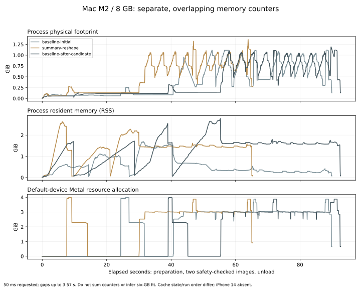

# Mac memory retest and iPhone 14 preparation

2026-10-14, Mac mini M2, 8 GB, macOS 27.0.1 / 26A434. Same pinned 4-bit model bytes, 512×512, four steps, apple prompt, seed 42. Every image passed the app's six-view output gate. This is **not a six-GB iPhone test** and does not change the production RAM guard or distributed weights.

| Run | Preparation | First checked image | Checked repeat | Sampled footprint peak | Kernel lifetime footprint peak | Metal allocation peak |
| --- | ---: | ---: | ---: | ---: | ---: | ---: |
| Standard, initial | 26.99 s | 40.18 s | 22.30 s | 1.119 GiB | 1.120 GiB | 3.986 GiB |
| Summary metadata + reshape hint | 9.19 s | 38.87 s | 16.87 s | 1.360 GiB | 1.360 GiB | 3.983 GiB |
| Standard, after candidate | 40.35 s | 32.78 s | 19.13 s | 1.191 GiB | 1.191 GiB | 3.986 GiB |

All six outputs have identical raw pixel SHA-256: `eee5ad8412b4785d45395289b268a0a9820c920efdd9153b77971e05bab1be35`. The candidate's observed repeat time was comparable or faster in these short runs; cache state, run order and system load vary, so this does not prove a statistically isolated speedup. The first-image time includes runtime/function loading still needed after prompt preparation; it is not a fresh-device or fresh-OS benchmark. PNG encoding/writing is outside the image timing.

The candidate combines two changes in an isolated runtime copy: asset-summary metadata lookup and Apple's public `expectFrequentReshapes` hint for the transformer. It saved preparation work on this Mac and completed checked generation. **It did not materially reduce peak Metal allocation.** Its effect on the A15 / iOS 27.2 allocation failure remains unknown. [Apple setting](https://developer.apple.com/documentation/coreai/specializationoptions/expectfrequentreshapes)

The sampler requested 50 ms on a separate serial queue, but recorded gaps of up to 3.574 seconds. Timer scheduling and native work can delay sampling. Kernel ledger high-water marks help capture footprint spikes between samples in successful processes; they cannot be read after a fatal abort. RSS and Metal totals are separate metrics, and Metal counts come from one default device object. None are added to infer total physical RAM. Mac swap and iOS limits also differ.

The standard transformer's isolated asset/function loading completed, but that test did not execute the denoiser and had much smaller resource counts. Full inference and component loading must not be treated as equivalent tests.

Raw per-run reports, runtime events and CSVs are in the three named folders. `summary.json` contains source provenance, compile scope, exclusions and limits; `timings.csv` contains the six valid image timings. The two PNGs are actual approved outputs.

## iPhone preparation

The lower-guard, warm-policy, summary/reshape test source compiled for generic iOS in Release. This compile check bundled the small classifier and omitted generation weights. The phone was not installed or executed in this retest. Build the isolated copy with `LOCAL_FLUX_EMBED_MODELS=YES`, sign it and connect the intended device before attempting inference.

The first iPhone 14 failure was native allocation during MPSGraph preparation, before any denoising step. Requested allocation size is still unknown. New background sampling and optional ARM64 allocation-request debugger commands are ready in [the experiment](../../../Experiments/FluxMemoryRetest/README.md). No success or required-RAM minimum has been inferred from the Mac data.

## Bonsai comparison

The [comparison table and common fixtures](../../../Experiments/FluxMemoryRetest/README.md) separate PrismML's published figures from local measurements. Its 9.4-second example uses iPhone 17 Pro Max; the current app's physical timings use iPhone 17 and include six safety checks. Average active-memory figures are not directly comparable to these footprint peaks or Metal allocation counters. Bonsai was not run locally during this retest, and no matched quality/speed superiority claim is made.

Preparatory runs with symlink assets, an iCloud metadata wait, a stale executable during a build and a relocated executable lacking its resource bundles were excluded. The final models were regular files outside iCloud, verified against every pinned hash; runtime events verified the correct lookup variant for each published run. The shipping app and CDN remain unchanged.
