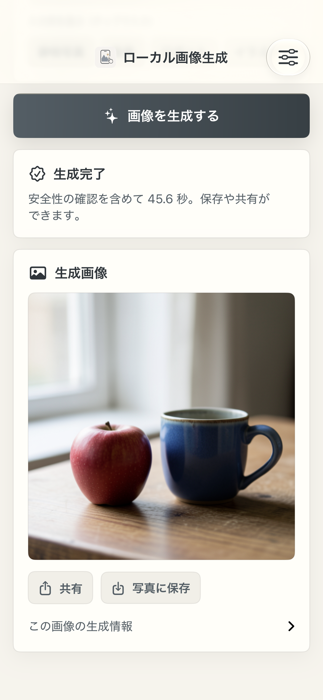
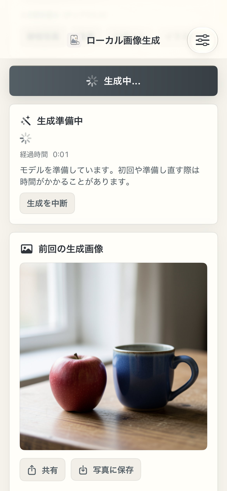

# App usability and safety regression check — 2026-10-15

Version **1.1 (5)** adds four labelled prompt examples, elapsed preparation/generation time, clearer cancellation status, image-first results, collapsed prompt/seed details and permission-aware Photos saving. A previous approved result and its metadata now survive the next operation's refusal, failure or cancellation. Sharing captures the selected checked image. The app also contains its own required-reason privacy manifest.

[Summary and source hashes](summary.json) · [Native driver records](device-validation.json) · [Timings](timings.csv) · [Signed normal bundle checks](normal-bundle-validation.json)

## Physical check

An isolated startup driver called the production view model and share presentation methods on **iPhone 14, 5,986,615,296 physical RAM bytes, iOS 27.2 / 24B5099f**. It completed **43 assertions**. It reused the verified downloaded installation and existing compilation caches, with the production RAM guard, four steps and six-view image gate. It did not override model, memory or safety settings.

| Example, seed 42 | App time including safety | Result |
| --- | ---: | --- |
| Still life | 45.6 s | Approved |
| Landscape | 50.8 s | Approved |
| Robot | 55.9 s | Approved |
| Watercolor illustration | 57.3 s | Approved |

These are functional cases with changed prompts, after separate initial preparation. They are not a matched speed comparison. CSV wall times additionally include driver polling.

The check confirmed example selection, new approved image IDs, matching prompt/seed metadata, retention during the next generation, eight input refusals, empty input and invalid seed handling. It cancelled active diffusion after step progress began, cancelled preparation, invoked view-model background/resume methods, and presented/dismissed the actual sharing sheet. The retained image's pixel hash and metadata stayed unchanged throughout the failure/cancellation checks.

| Checked result | Next generation retains it |
| --- | --- |
|  |  |

[Landscape](result-landscape.png) · [Robot](result-robot.png) · [Illustration](result-illustration.png)

No share destination was selected or message sent. System sharing suggestions can contain personal contacts, so no screenshot of that sheet was retained. Lifecycle method calls do not prove OS suspension or recovery after process termination. Permission dialogs and actual Photos writes remain untested in this run.

XCTest's separate input-example tap test did **not execute**: its runner timed out while enabling the device's automation mode. Startup-driver results must not be described as XCTest tap coverage.

## Input-policy correction and package tests

Added cases exposed six missing multilingual phrases in the previous input policy. Revision `local-generation-20261015-v2` adds those phrases. All **54 blocked cases and 20 ordinary prompts** now pass, including Unicode obfuscation and benign word-boundary cases. Nine safety test functions and fifteen generation/optimization/installer test functions passed. The classifier model, image thresholds and six-view output gate are unchanged.

This is regression coverage, not a measured classifier false-negative rate or proof of broad adversarial effectiveness. No harmful images were generated for this check. App Review acceptance remains unverified.

## Provenance and reproduction

`probe-provenance.json` preserves the source hashes captured when preparing the tested copy. `summary.json` adds final shipping hashes and identifies the later button-label and privacy-wording changes; inference and result-retention code did not change after the native check. A signed normal build was separately checked for the app-root privacy manifest, policy revision and absence of startup-driver markers.

```sh
python3 scripts/prepare_setup_probe.py --readiness \
  --destination /tmp/local-image-generation-readiness \
  --bundle-id com.tasuku.sdxlcoremltest
```

Build the copied target and launch it with `--app-readiness` on an installed, prepared development device. It generates four benign images and presents/dismisses sharing without choosing a destination. The optional `--photo-save-validation` also requests add-only Photos permission and saves one checked image; use that flag only for a planned permission/write test. Test hooks are confined to the copied source. Collect `Documents/AppReadinessValidation` from the app container after `complete`.
