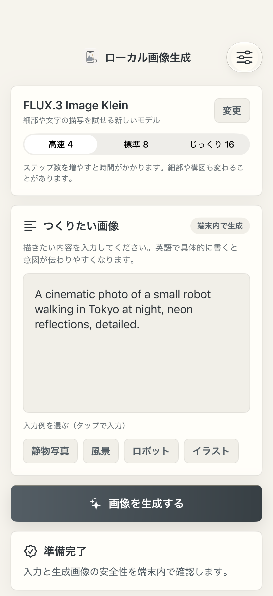
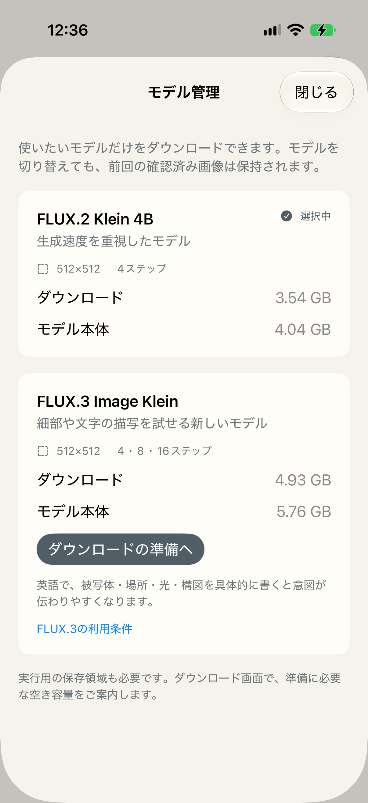

# Main app model selection integration — 2026-10-18

Scope: development changes to ローカル画像生成, with a separate
`com.tasuku.sdxlcoremltest.preview` installation on iPhone 17
(iPhone18,3 / iOS 27.0.1 / 24A446 / 8,045,641,728 physical memory bytes).
No App Store action or MiM integration change is included.

## Distribution

`r2-upload.json` records full public-GET size and SHA-256 verification for all
27 objects: 25 binary fragments and two JSON manifests. Existing FLUX.2 objects
were preserved. The 4,925,833,766-byte FLUX.3 archive contains 144 files totaling
5,764,051,319 uncompressed bytes. `archive-validation.json` records an independent
Python ZIP64/CRC/per-file-SHA validation of the entire archive before upload.

The pinned app manifests are copied here. The archive is not committed. Use
the public fragment URLs in `flux3-download-manifest.json` to reproduce the
download. Full model licenses, derivative notices, offline tokenizer data and
native runtime configuration are included in the payload.

## Verification boundaries

- `unit-tests.log`: 22 tests passed, including independent model storage, the
  legacy package contract, >4GB resume offsets, unsupported samplers, blocked
  input, missing classifier and seven Swift/Python tokenizer comparisons.
- The optional ZIP64 test reads the real central directory and extracts two
  original compressed records at offsets about 2.61 GB and 4.83 GB using the
  app's ZIPFoundation 0.9.20 dependency. Other local headers/descriptors in that
  sparse fixture are reconstructed from the central directory; this is not a
  second complete archive validation. `zip64-preflight-fixture.json` states this
  scope. The independent full-archive validation is separate.
- An XCTest tap run performed FLUX.2's public download, pause, process relaunch,
  resume, verified installation and one approved image. Its UI reported 31.5 s
  including safety after separate preparation, with the first compilation cache.
  The suite then stopped on a test accessibility-identifier lookup; the captured
  hierarchy shows the approved image, correct model/four steps and seed 42.
- Later XCTest runners failed to initialize automation mode before starting a
  case. The main app's download/generation methods were consequently exercised
  with a test-only startup driver in the Preview bootstrap. It does not replace
  the installer, VM, runtime or safety gate, and is not claimed as completed UI
  tap coverage. The source driver is `scripts/device-probe/ModelSelectionValidation.swift`.

The FLUX.3 native-driver run paused at 14,274,150 bytes, terminated the process,
and resumed with exactly the same saved byte count. It installed the complete
public archive through the ordinary installer, preserving FLUX.2. All three new
images passed six output views. Refusal, active cancellation, switching back to
FLUX.2 and returning to FLUX.3 preserved the approved image and its original
model/steps/prompt/seed. See `native-core-report.json`.

An additional setup change resumes a cancelled installed-file verification
without downloading another archive. It passed on the same phone, followed by a
warm four-step image after process relaunch. Its pixels matched the first
four-step image exactly. `device-report.json` includes both runs and all scores.

## Native app results

All cases use the same new lighthouse caption and seed 42, with 512px output.
The app's displayed time includes safety and excludes separate initial model
verification/preparation.

| Case | App-reported time |
| --- | ---: |
| 4 steps, first image after download/first CoreAI compilation | 60.0 s |
| 8 steps, after the first image | 40.0 s |
| 16 steps, after the eight-step image | 78.5 s |
| 4 steps, after relaunch with compilation caches populated | 23.9 s |

These are single integration cases; cooling and thermal conditions were not
controlled. The first image includes new function specializations. The times
are not a matched-cache speed comparison between steps or models.

| 4 steps | 8 steps | 16 steps |
| --- | --- | --- |
|  |  |  |

`native-core-storage-summary.json` records about 9.79 GB of combined CoreAI
compilation cache plus 9.81 GB of model files for both models on this Preview
installation. This is disk usage, not RAM or GPU allocation. The model manager's
delete action removes the selected unused model's downloaded files/partial
archive; system compilation caches remain managed separately.

The two native source snapshots and provenance records distinguish the original
core run from the later verification-resume check. `source-provenance.json`
records the ordinary Preview build restored after the driver, with all main-app
Swift files matching the checkout and no validation startup flags. The earlier
partial-tap screenshots are described in `ui-tap-summary.json`; full tap coverage
is not claimed.

## Interpretation

These are named integration checks, not a general quality, safety-detection-rate,
thermal or latency benchmark. First-use compilation, prompt preparation, cache
state and UI/driver polling have different timing boundaries. The earlier
fixed-caption step-count experiment is a separate dataset. Generated PNG files
are exported only from the typed safety-approved result.

The ordinary Preview build has separate preferences/model storage from the
released app. Model weights are excluded from its bundle. See
[integration/reproduction instructions](../../../docs/flux3-app-integration.md)
for model choices, space requirements, license terms and the Preview preparation
script. App Store submission and future commercial distribution require their
own release review.

## Public copy

The public copy omits the earlier UI build executable-provenance receipt and an
unused duplicate comparison PNG. It retains the complete native run receipts,
checked result PNGs, source snapshots and final ordinary Preview provenance.
Device identifiers and private connection addresses are redacted. Publication
artifact manifests are recomputed after redaction; code/model hashes are retained.
