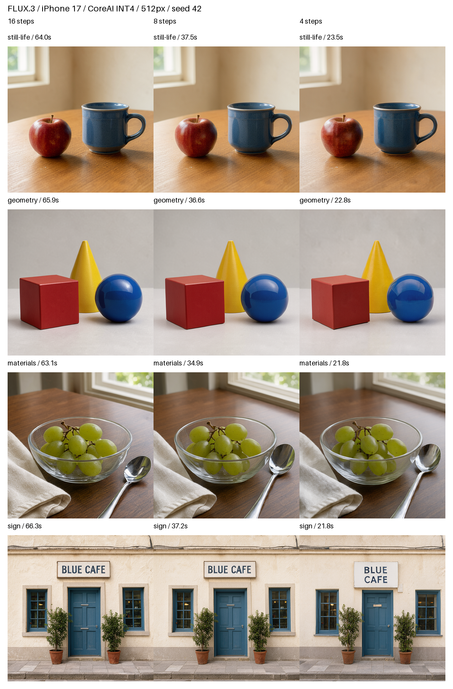
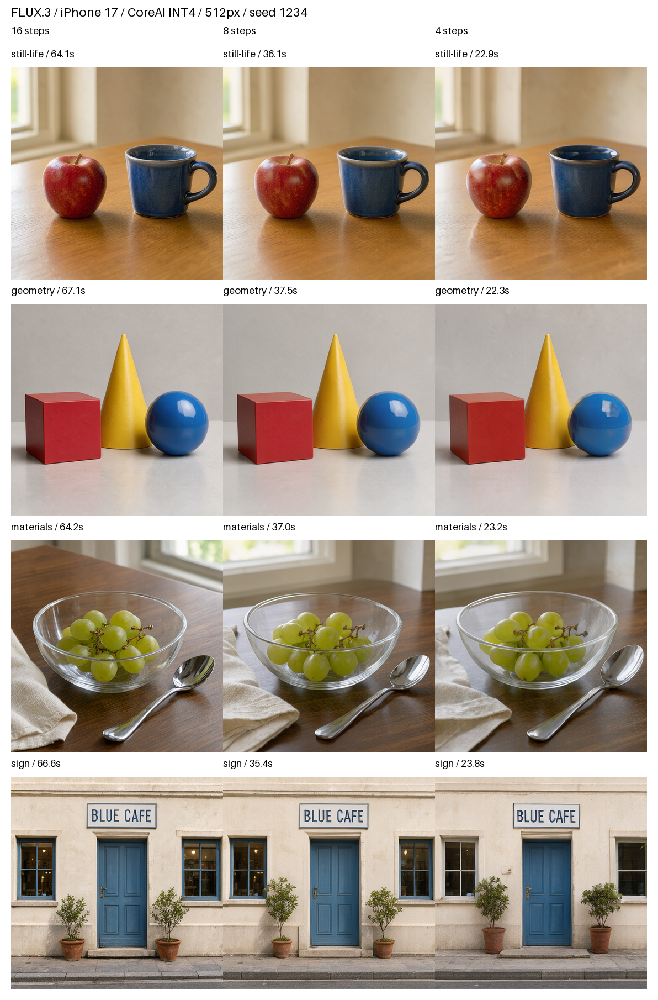

# FLUX.3 CoreAI / iPhone17の16・8・4ステップ比較

2026-10-18、物理iPhone17（iPhone18,3、iOS27.0.1 / 24A446）で実施。
固定キャプション4題材×seed42 / 1234×16 / 8 / 4ステップの24枚と、16ステップの暖機1回。
**全25回で実モデルからの生成、六視点の安全判定、PNG保存が完走した。**

## 速度

題材・seedの同じ三条件すべてで、各ステップの熱状態がnominal / fair（0 / 1）の組を比較。
暖機と、serious（2）を含んだgeometry-seed1234の三条件は主比較から除外した。
生データは除外せず全25回を保存している。

| 条件 | 各ステップ数の組数 | ステップ | モデル処理の平均（範囲） | 検証開始から保存までの平均 |
| --- | ---: | ---: | ---: | ---: |
| 送風開始前 | 3 | 16 | 64.67 s（64.01–65.87） | 68.35 s |
| 送風開始前 | 3 | 8 | 36.74 s（36.13–37.46） | 40.41 s |
| 送風開始前 | 3 | 4 | 23.06 s（22.83–23.46） | 26.71 s |
| ユーザー申告の送風開始後 | 4 | 16 | 65.04 s（63.11–66.62） | 68.75 s |
| ユーザー申告の送風開始後 | 4 | 8 | 36.15 s（34.87–37.25） | 39.85 s |
| ユーザー申告の送風開始後 | 4 | 4 | 22.63 s（21.75–23.76） | 26.25 s |

送風前の同条件比較では16→8でモデル処理が約43.2%、16→4で約64.3%短縮した。
送風開始後の同条件比較でも16→4は約65.2%短縮した。題材が異なるため、送風前後の差を
ファン単独の効果とは扱わない。送風の強さ、筐体温度、周囲温度は計測していない。

モデル処理はQwen＋文章条件の事前計算＋DiT＋VAEの壁時計時間。単独GPUカーネル時間ではない。
保存までの時間はアプリ内の検証開始を起点とし、全アセットのSHA照合、入力・出力安全性確認、
画像変換、PNG保存を含む。OSがアプリを起動するまでや、画面表示までの時間は含まない。

[全25回の値](all-runs.md)、[機械可読集計](summary.json)、[測定順と条件](protocol.json)。
図中の秒数はモデル処理時間。

## 画質の目視比較

各図は左から16 / 8 / 4ステップ。同じ題材・seed内で初期ノイズとトークンを固定した。
全24枚を個別の512px画像と比較シートの両方で確認した。

| 題材 | 観察 |
| --- | --- |
| 静物・seed42 / 1234 | 全条件で赤いリンゴと青いマグ、左右関係、持ち手を維持。4では釉薬や木目などの細かな質感が変わる。 |
| 位置・形・seed42 / 1234 | 全条件で赤い立方体・青い球・後ろの黄色い円すいを維持。球の反射や辺の見え方に差。seed42の円すいの平らな先端は16側にもある。 |
| 材質・seed42 | ガラスの器、ぶどう、右の金属スプーン、左の布を維持。反射、果皮、織り目の細部に差。 |
| 材質・seed1234 | 8 / 4では16より視点が低く、背景の窓が大きく見える。構図の変化もあり、細部だけの差とは言えない。 |
| 看板・seed42 | 3条件ともBLUE CAFEを目視で正しく読める。16 / 8は1行、4は2行となり、看板の縦横比も変わる。 |
| 看板・seed1234 | 3条件ともBLUE CAFEを1行で読める。植木の大きさ、壁・窓の見え方は変わる。 |

今回の8組では4ステップでも主要な内容を保ち、大きな物体の欠落は確認しなかった。
8は静物などで16に近いが、常に同じ構図になるわけではない。4は高速モードとして有望だが、
16と同一画質・同一構図の保証ではない。人物、手、長い文字列、幅広い自由入力は未検証。

16との画像距離は8組ずつで、SSIM平均は8ステップ0.8196、4ステップ0.7003。
視点・構図が変わる例の影響も含む。これは品質維持率や人間の好みの点数ではない。
MAE / PSNR / SSIMの各値は[distances.json](distances.json)に保存した。

## 安全性確認とメモリ

原文と長文キャプションの入力検査を毎回実施し、出力は六視点のすべてを通過してから保存・表示。
入力ポリシー、分類器、閾値、失敗時に保存しない処理は従来と同じ。
今回から入力検査、安全モデル準備、六視点判定を別々に計測した。

比較24枚の六視点判定は平均約0.137秒、範囲0.123〜0.207秒。
安全モデルの準備は繰り返し実行で平均約0.032秒。最初の暖機では準備約0.170秒、判定約0.189秒。
入力ポリシーは各回約0.003秒。安全性確認は今回の生成時間の主因ではない。
個別値と[安全性タイミング集計](safety-timing-summary.json)を保持した。

メモリは50msを要求したphys_footprintのサンプル最大。CSVから全25回の最大値を再集計し、
レポートと一致した。各ステップ数の平均は約1.17〜1.19GBで、今回の変更は主に時間を減らす。
瞬間ピークや端末全体、Metal単独の割当量を測る値ではない。
[検算結果](memory-integrity.json)に実際の最大サンプル間隔も記録している。

## 冷却と実行順

ステップの実行順を題材・seedごとに回転し、実行間に20秒休止した。
geometry-seed1234の8 / 4でseriousになったため、ハーネスを追加で約98秒休止した。
休止開始時に4ステップの生成が実行中であり、その生成自体は停止していない。
その後ユーザーから送風開始の申告があり、materials / signの4組は別集計した。
発熱の除外ルールは最初の8 / 4ステップが完了する前に記録済み。

[事前に決めた集計基準](predeclared-analysis-policy.txt)、[追加冷却の記録](additional-cooling-01.json)、
[送風の申告](airflow-user-report.json)、[条件の分類](cooling-cohorts.json)、[進行ログ](run.log)。

## 実装と再現性

- Releaseビルド成功。全実行が同じ実行ファイル。試験ソースは[GenerationProbe-tested.swift](GenerationProbe-tested.swift)。
- 重み、量子化、解像度、実行グループは共通。ステップの時刻指定だけを4 / 8 / 16へ変更。
- alpha6.93の参照スケジュールと全点で数値一致。全条件が時刻1→0まで進み、途中停止ではない。
- 各時刻のcurrent_t / target_tに合わせて文章条件も事前計算する。
- 全入力fixtureをハッシュ照合。[fixture-manifest.json](fixture-manifest.json)にノイズ、トークン、マスク等のSHAを保存。
- 暖機のPNGは以前のiPhone17の16ステップ画像と完全一致（f71fb682f82e7c16d4eba4a3bfd43312637e9b8c12789f130f58eb9c923da674）。
- 生PNG名には旧seed42表記が残る。実際のseedは実行フォルダ・fixture・reportのseedを正とし、名前から推定しない。

[ビルドとソースの来歴](build-provenance.json)、[再現スクリプトと手順](../../../Experiments/Flux3CoreAI/STEP_COUNT.md)。
全実行フォルダにreport.json / memory.csv / component-timings.jsonl / analysis.json / PNGを保持する。
比較シートは確認済みPNGだけから作成し、元画像も別に保持した。
提出済みFLUX.2アプリ・AppStoreの変更ではない。実験用の16ステップ既定値は維持している。
