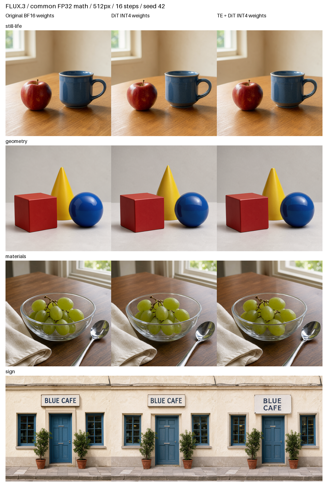
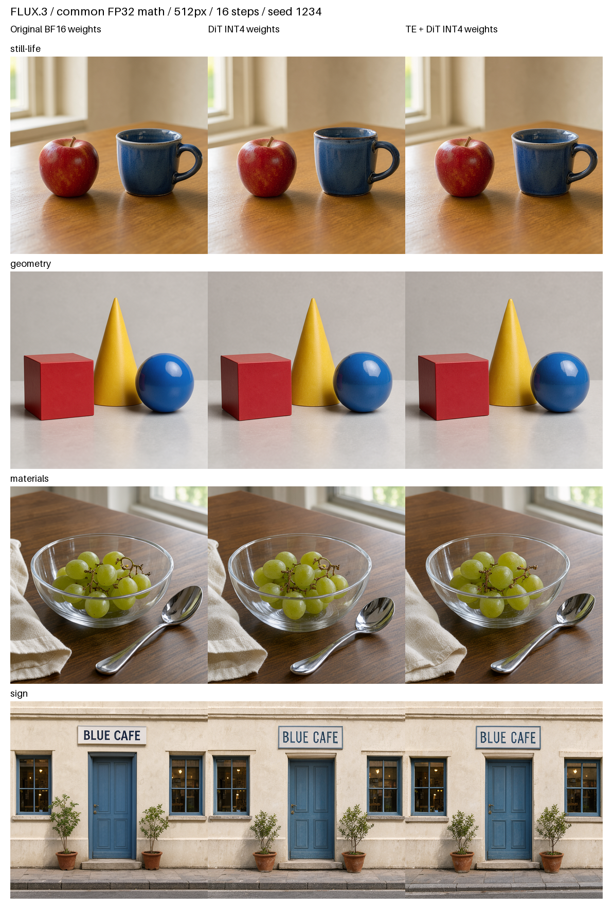

# FLUX.3 元の重み / 実 CoreAI INT4 の比較（2026-10-18）

Windows の Tesla V100-PCIE-32GB で24枚を生成し、Mac の入力ポリシーと六視点の出力判定をすべて通過した画像を保存した。4種類の固定キャプション × 2 seed × 3条件。512×512、16ステップ。

全条件を共通 FP32 計算に揃え、元の BF16 チェックポイントと実際に抽出した INT4 Linear 重みを比較した。端末の BF16 / FP16 活性値や融合演算を再現する試験ではなく、iPhone の速度計測でもない。

## 観察した画像の変化

- リンゴとマグ、ガラスの器、ブドウ、布、金属の見た目と主要な配置は両 seed で保たれた。反射・粒の形・木目などの細部は変わる。
- 幾何形状の色と左右関係は保たれた。一方、seed42 のQwen＋DiT INT4 では円すいの先端が平らになっている。
- 看板の BLUE CAFE は3条件・両 seed で読める。seed42 のQwen＋DiT INT4 は文字が2行になり、扉・看板・鉢の配置にも変化がある。seed1234 では看板の枠と書体、窓・扉の形に差が見える。
- この小標本では全体に大きな画質崩壊は見られないが、細部や構図の一致を保証する結果ではない。文章モデルの追加量子化も一律に悪くなるわけではなく、看板の条件で変化が大きかった。

## 元の画像からの距離

各条件の8画像について算術平均を記載。SSIM は一様7×7窓・不偏共分散・有効領域平均。これらは画素や潜在の差であり、品質維持率や主観的な画質スコアではない。

| INT4 にした部分 | MAE (0–1) | PSNR dB | SSIM | SSIM 範囲 |
| --- | ---: | ---: | ---: | ---: |
| DiT | 0.0379 | 23.79 | 0.8653 | 0.7422–0.9627 |
| Qwen + DiT | 0.0439 | 23.14 | 0.8453 | 0.6412–0.9657 |

| 題材 | DiT INT4 の平均 SSIM | Qwen + DiT INT4 の平均 SSIM |
| --- | ---: | ---: |
| still-life | 0.9088 | 0.9169 |
| geometry | 0.9565 | 0.9643 |
| materials | 0.8397 | 0.8357 |
| sign | 0.7561 | 0.6644 |

[全16組の距離](distances.md)、[集計JSON](distance-summary.json)、[生レポート](summary.json)。保存済み PNG から MAE / PSNR 全16組を再計算してリモートの値と照合した。

## 比較画像

列は左から元の重み、DiT INT4、Qwen + DiT INT4。3条件とも FP32 演算。画像は縮小表示で、元の512px PNGは `images/` に保存している。

## 来歴と限界

- Python3.11.17、PyTorch2.8.0+cu126、CUDA12.6、V100 capability7.0。全数の元チェックポイント SHA は `*-source.json`。
- INT4 は CoreAI 70部品・452行列から packed bytes と scale を抽出。再量子化していない。抽出元アセットとファイルのハッシュは `extracted-weight-receipts/`。大きな重みファイルは含めない。
- Windowsの主要5ソースとMac側のSHA一致は`remote-code-hashes.json`、コードと入力は`code-manifest.json`・`source-code/`・`fixtures/`に記録。公開準備時にもWindows側の同じ5ファイルを読み取り専用で再照合した。
- 一層の抽出検証は `extracted-weights-validation.json` と `extracted-text-validation.json`。画像品質の評価とは区別する。
- V100 上で文章条件の事前計算を有効にした一例（still-life / seed42）は、通常経路と最終潜在が完全一致。`precompute_algorithm_check` に記録。
- CUDA の最大 allocated / reserved はそれぞれ 20,058,246,144 / 20,828,913,664 bytes。端末の `phys_footprint` とは別指標。
- Windows は潜在と数値だけを保持し、未確認の PNG を保存しない。Mac で六視点すべて SFW ≥ 0.90、NSFW + NSFL ≤ 0.10 の確認後に保存。全24枚のハッシュと判定は `safety-receipts.json`。これはモデル全体の安全性評価ではない。
- 人物・複雑な手・長い文字列などは未評価。固定4キャプション、各2 seed なので、任意のプロンプトへ一般化しない。

コードと再現手順は [QUALITY.md](../../../Experiments/Flux3CoreAI/QUALITY.md)。iPhone 14 の高速化は [別の計測](../flux3-coreai-precompute-iphone14/README.md)。新しい iPhone 17 実測は行っていない。
